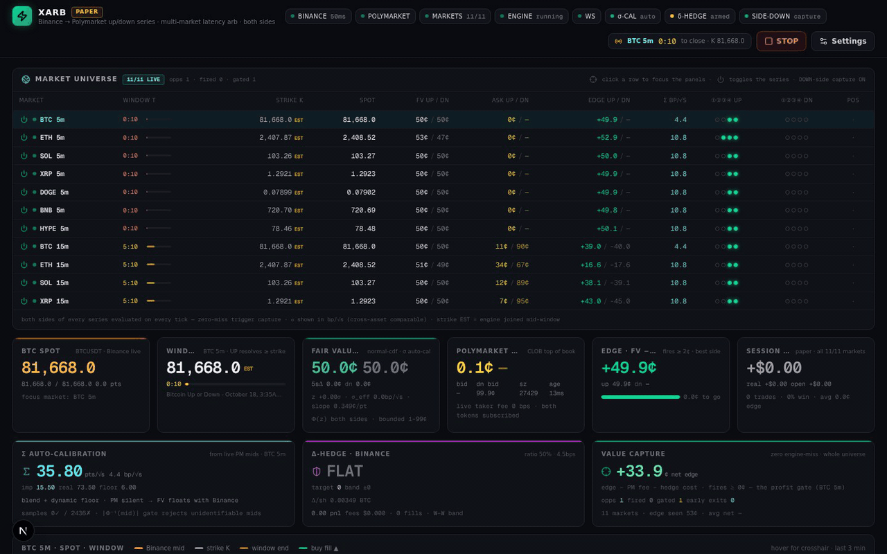
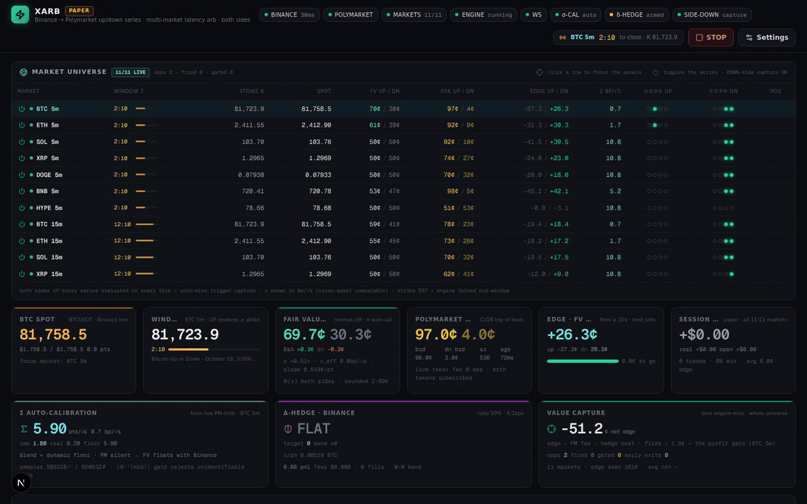
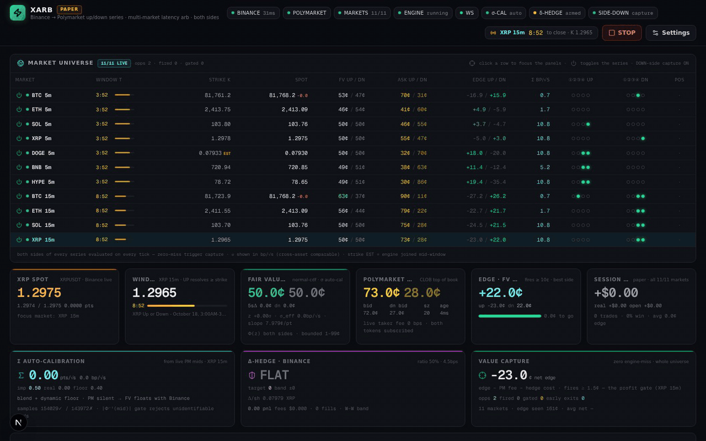
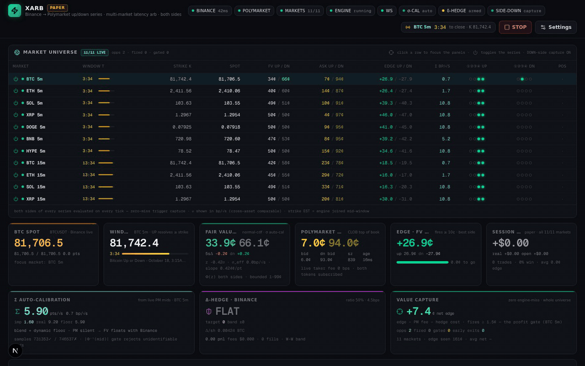
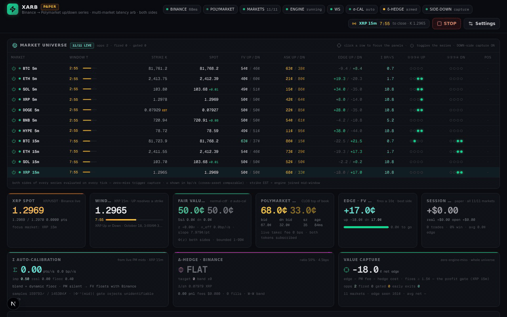

# XARB — Binance → Polymarket latency arbitrage, every up/down market, both sides, δ-hedged

> A research terminal that watches **every rolling Polymarket up/down series** (7 assets × 5-minute + 4 × 15-minute windows, UP **and** DOWN tokens), prices each side against **live Binance spot** with a σ-auto-calibrated digital-option model, fires the moment all trigger conditions align on any market, and **delta-hedges the binary exposure on Binance** in real time.

**Everything below is live, real feeds — no mocked data.** Binance WebSocket (~18k ticks/min), Polymarket CLOB WebSocket on both tokens of every market, Chainlink-window strikes, paper fills that walk the live ask ladder.



*The moment: BTC 15m UP — model FV 52.3¢ vs a 30.0¢ Polymarket ask. All four conditions align in a single tick → EXECUTED 83 shares @ 30.0¢ (edge +22.3¢, **net +18.5¢ after the 1000 bps taker fee + hedge cost**) → initial δ-hedge SHORT 0.0076 BTC on Binance → Whalley–Wilmott band re-hedges, risk-reduce only into the wind-down zone.*

---

## The strategy (evaluated on every tick, both sides, every market)

BUY a side when **all four** hold in the same tick:

| # | Condition | Meaning |
|---|-----------|---------|
| ① | 5s FV jump ≥ 20¢ | Binance momentum just repriced the digital |
| ② | FV > 60¢ | the side is favored to win |
| ③ | Polymarket ask ≥ 10¢ under FV | the book hasn't caught up — that's the edge |
| ④ | net edge = edge − PM taker fee − est. hedge cost | **profitability gate** — no fire unless it clears the floor |

**Fair value** is a proper digital option: `FV = Φ((S − K) / (σ_eff·√τ))` — not a heuristic. `σ_eff` is **auto-calibrated per market from that market's own live Polymarket mids**: implied σ inverted through Φ⁻¹ on every fresh book print (identifiability-gated), EWMA-fused with that asset's realized vol behind a dynamic median floor, and **snap-pinned to the market's own quote while it prints** — so FV tracks Polymarket, and edge only appears in the genuine reaction-lag window. No phantom edge from basis mismatches: near-ATM / spread-distorted quotes are rejected by the |Φ⁻¹(mid)| gate.

Every fill is **δ-hedged on the market's own Binance symbol** (Whalley–Wilmott no-trade band, wind-down risk-reduction near expiry, force-flatten, exact cash-flow accounting), and an early-exit engine banks the mispricing when Polymarket re-converges — value captured before expiry gamma.

---

## The terminal, in motion

**Full tour** — universe → live stats → σ-cal / δ-hedge / value-capture cards → charts → triggers + CLOB + latency → signal feed & blotter:



**Market universe** — 11 series live at once; click a row and every panel, chart, and order book rebinds to that market; power-toggle any series on/off live (11/11 → 10/11 → 11/11):



**Every setting is live** — drag a trigger threshold and the engine re-evaluates on the next tick; the trigger LEDs, edge cards, and gate behavior all change in real time; restore-defaults puts the spec back:



**The CLOB and charts** — the real Polymarket order book ladder for both tokens of the focused market (depth bars, live prints), price + FV-vs-ask charts with crosshair, strike, and positive-edge shading:



---

## What's running under the hood

```
Next.js terminal (:3000)  ←→  socket.io  ←→  TS engine v0.5.1 (:3011)   ←→  Caddy gateway (:81)
                                              │
        combined Binance WS (7 symbols) ──────┤  11 Polymarket CLOB sockets (UP + DOWN tokens)
                                              │
                                              └─ xarb-rs — the Rust HFT core (:3002)
```

- **Engine (TypeScript, `mini-services/xarb-engine`)** — multi-symbol Binance WS with live re-subscribe; per-market CLOB sockets on **both** tokens; per-market Σ-calibrators, FV rings, capture accounting; event-driven evaluation on **every** market tick; window rollover per series (settle → discover → resubscribe); every setting validated, clamped, and applied live; settings persist and survive restarts.
- **Rust core (`xarb-rs`)** — the same strategy as a pinned, lock-free pipeline: wait-free SPSC rings, bit-packed hot word, per-stage pinned threads, zero allocations on the decision path, EIP-712 order signing byte-compatible with the official client. Local per-stage latencies: **parse p50 3µs → FV 0.36µs → detect 10–46µs** (eco park-wake; ~50–200ns in pure-spin). Network RTT dominates — the code is never the bottleneck. 80/80 tests.
- **Port parity is test-locked** — 74/74 TS tests port the Rust unit suite, including the original spec example (FV 77¢ @ +130pts, fires at net +8.6¢, full-ratio mid-gamma entry rejected by the cost gate).

### Risk controls surfaced by live trading (v0.5.1)

The engine now refuses the failure modes a naive implementation walks into:

- **Dead-quote guard** — sub-3¢ asks near expiry are stale ghost liquidity; fill sizing would explode the share count and the model delta then demands an absurd hedge. Rejected with an explicit logged reason.
- **Hedge notional cap** — |hedge target| is clamped to stake × 600, blocking model-σ blow-ups near expiry from demanding seven-figure hedge notionals.
- **Unconditional wind-down add-block** — in the last 20s the digital is nearly decided; the hedger may only risk-reduce (toward flat), never add, no matter what the model delta claims.

---

## Fee reality (the honest part)

The 5-minute series carries a **1000 bps taker fee**. A naive "buy under FV" bot bleeds to death here; XARB's gate subtracts the live fee (fee-on-proceeds shape, `bps/10⁴·min(p, 1−p)`) **and** the estimated Binance hedge cost (2.5× turnover of entry-delta notional at 4.5 bps) before any fire. Full replication of a mid-gamma 5-minute digital costs roughly the entire entry edge — the fractional default (0.5) is the cost-aware optimum, tunable live. The fire shown above cleared the gate at **+18.5¢/share net**.

## Repo layout

```
src/                      Next.js terminal (universe grid, trigger panels, CLOB ladder, charts, settings)
mini-services/xarb-engine  live engine v0.5.1 (multi-market, both sides, σ-cal, δ-hedge, capture accounting)
xarb-rs/                  Rust HFT core (lock-free pinned pipeline, EIP-712 execution)
scripts/                  probes + the GIF recorder that produced media/
media/                    the recordings above
```

## Quickstart

```bash
bun install
bun mini-services/xarb-engine/index.ts   # engine :3011 (supervises itself)
bun run dev                              # terminal :3000
# open http://localhost:3000 (or the gateway on :81)
```

Paper trading for research — **no orders are sent**; hedge fills cross the live Binance top-of-book in paper mode. Windows resolve on Chainlink oracles; the terminal settles paper positions on the Binance mid as a proxy. Not financial advice; check Polymarket eligibility & terms before trading real funds.
